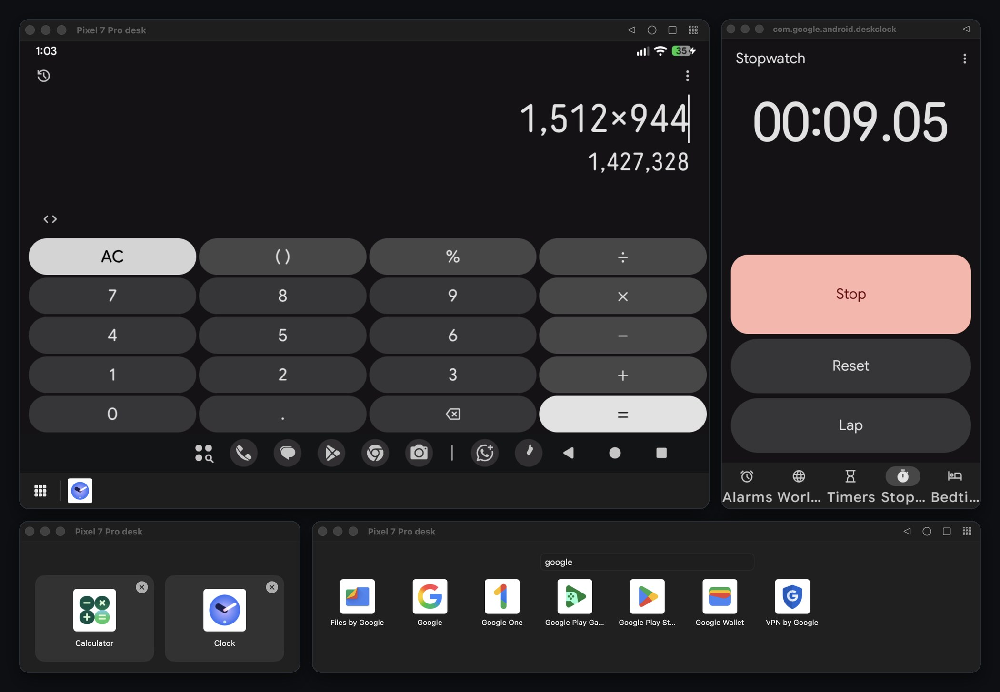

# MIRROR

Use an Android phone from a Mac. Each phone app opens in its own Mac window while the phone stays locked on the desk, and the clipboard, files and audio follow. It runs over adb, by USB or Wi-Fi, with no root and nothing to install on the phone apart from an optional companion app.


Tested on a Pixel 7 Pro (Android 17, not rooted) and a MacBook Air on macOS 26.



## What works

- **Desk mode.** Phone apps run on a virtual display sized to a Mac window, while the phone itself stays locked with its screen off. Someone who picks up the phone sees the lock screen.
- **One window per app.** `mirror-window app <package>` opens a single phone app in its own Mac window.
- **Native mirror window.** H.265 at 16 Mbit/s, decoded by VideoToolbox and drawn with Metal. It started as scrcpy's SDL window with H.264 at 8 Mbit/s, which stuttered.
- **Trackpad that feels like touch.** Two-finger scrolls become one-finger drags, so Android flings them like a real swipe. Pinch becomes two fingers.
- **Back, Home and an Overview the Mac draws.** Android hides its own navigation on a virtual display behind the lock screen, and has no Recents there, so the Mac reads `dumpsys activity activities` and draws them.
- **Clipboard both ways**, with server-side polling for the phone-to-Mac direction.
- **Drop a file to send it**, with a progress bar. A push stopped on Wi-Fi resumes over USB, or the other way round.
- **Quick Share from the phone**, built in from NearDrop's code.
- **Phone audio on the Mac** as raw PCM with a 60 ms start buffer.
- **No cable after a reboot.** The companion app turns Wireless debugging back on when the phone joins your Wi-Fi, and the Mac finds the phone again through adb mDNS.

Not possible without root: apps that set `FLAG_SECURE` (most banking apps, incognito tabs) show black in every mode.

## How the hard parts work

**Desk mode with the phone locked.** Upstream scrcpy's virtual display goes dark about 7 seconds after the phone locks. On Android 14 and later it adds `VIRTUAL_DISPLAY_FLAG_DEVICE_DISPLAY_GROUP`, which ties the virtual screen to the phone's sleep state. Patch 0001 drops the flag, and a thread calls `IPowerManager.userActivity()` every 4 seconds so the display's own power group never sleeps. The adb shell user already holds `DEVICE_POWER` and `ADD_TRUSTED_DISPLAY`, so no root is needed.

**Resumable transfers.** `adb sync` cannot write at an offset. The Mac sends a file in 32 MiB segments to a hidden partial file, splices each one in place with `dd`, and renames the file when it is complete. Switching between USB and Wi-Fi repeats at most one segment. Measured: 25 MB/s resumable, against 33 MB/s for a plain `adb sync` push. A transfer stopped at 45% on Wi-Fi resumed over USB at 42%, and the md5 matched.

**Reconnecting after a reboot.** Over USB, the Mac grants the companion app `WRITE_SECURE_SETTINGS`. After a reboot, the app flips `adb_wifi_enabled` when the phone joins an approved network. It has no service and holds no wakelock. The Mac reconnects with the key it already authorised over USB, so there is no pairing code.

The four scrcpy-server patches are in `patches/scrcpy-v4.1/`: desk-mode virtual display, clipboard polling, app icons, and no lock-screen presentation on the virtual display.

## Build

Needs Xcode, a JDK for the scrcpy-server build, and a phone with USB debugging on.

```bash
make scrcpy-server                          # build the patched server
cd macos && swift build --product mirror-desk
swift test                                  # 89 tests
make phone-check                            # locate, clipboard round trip, desk stream
make companion                              # the Android companion app
```

## History

The first plan, written on 11 Nov 2026, reimplemented everything in Rust: its own protocol, Noise encryption, file mounts and a webcam bridge. Testing on a real phone on 18 Nov showed that scrcpy and NearDrop already solved most of it, so the plan was dropped. The Rust crates in `crates/` still build and pass their tests, but no app links them. `ROADMAP.md` has the test results that changed the plan, and the work still to do: notifications, 2FA codes, and the phone camera as a Mac webcam.
