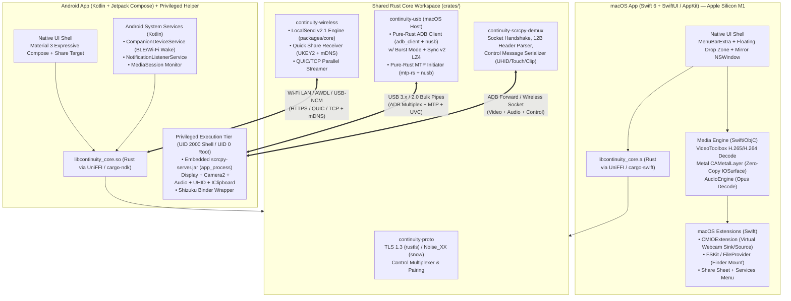
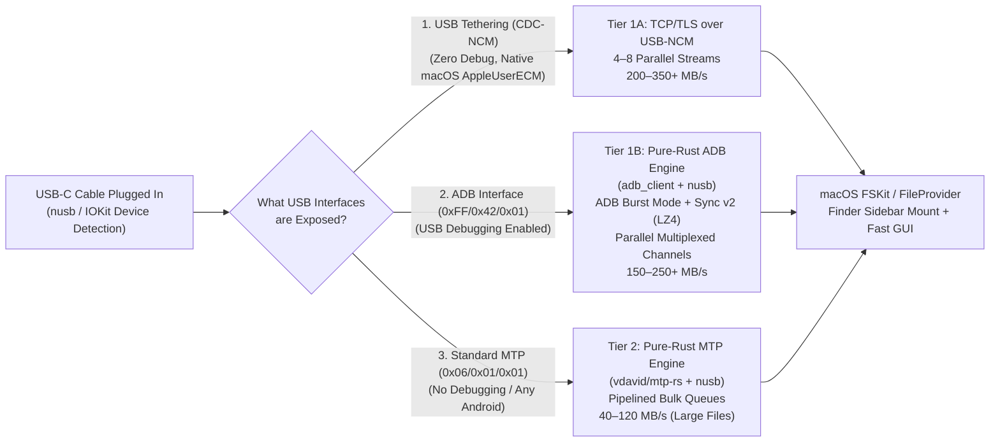
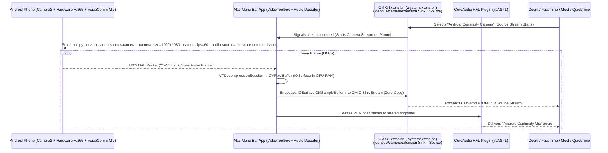

# Android ↔ macOS M1 Seamless Continuity Suite: Master Architecture & Open-Source Research Plan

> **Target Environment:** Android 12–17 (Kotlin / Jetpack Compose + System/ADB Daemon) ↔ macOS 15–26 on Apple Silicon M1+ (Swift 6 / SwiftUI / AppKit + System Extensions)  
> **Shared Core:** Rust (`tokio`, `rustls`, `quinn`, `mdns-sd`, `nusb`, `mtp-rs`, `adb_client`) bridged via Mozilla **UniFFI**  
> **Design Philosophy:** *"Connect and orchestrate battle-tested open-source engines rather than reinventing protocols; keep idle RAM under 30 MB and idle CPU at 0.0%."*

---

## Table of Contents

1. [Executive Summary & Unified Vision](#1-executive-summary--unified-vision)
2. [Tech Stack Decision & Cross-Platform Architecture](#2-tech-stack-decision--cross-platform-architecture)
3. [Category 1: Wireless File Transfer & Zero-Config Discovery](#3-category-1-wireless-file-transfer--zero-config-discovery)
4. [Category 2: Wired High-Speed Parallel Transfer & Finder Integration](#4-category-2-wired-high-speed-parallel-transfer--finder-integration)
5. [Category 3: Real-Time Screen Mirroring, Audio, App Streaming & `FLAG_SECURE`](#5-category-3-real-time-screen-mirroring-audio-app-streaming--flag_secure)
6. [Category 4: Seamless Continuity (Clipboard, Drag & Drop, Notifications, Input)](#6-category-4-seamless-continuity-clipboard-drag--drop-notifications-input)
7. [Category 5: Phone as Mac Webcam & Microphone](#7-category-5-phone-as-mac-webcam--microphone)
8. [Resource, Battery & Thermal Efficiency Engineering](#8-resource-battery--thermal-efficiency-engineering)
9. [Licensing & Legal Compatibility Audit](#9-licensing--legal-compatibility-audit)
10. [Master Repository Selection Matrix](#10-master-repository-selection-matrix)
11. [Phased Implementation Roadmap & Verification Strategy](#11-phased-implementation-roadmap--verification-strategy)

---

## 1. Executive Summary & Unified Vision

Today, Android-plus-Mac users must juggle four to six disconnected utilities—**LocalSend** or **NearDrop** for wireless drops, **SwiftMTP** or **OpenMTP** for USB transfers, **scrcpy** in a terminal for screen mirroring, **KDE Connect** or **AirSync** for notifications/clipboard, and **OBS + DroidCam** for webcam streaming. Each runs its own background daemon, maintains separate cryptographic pairings, polls the network independently, and brings its own UI runtime (Flutter, Electron, Qt, SDL). Together they easily consume **600 MB–1.2 GB of RAM** on macOS and cause measurable wakelock battery drain on Android.

Our goal is to unify these capabilities into a single, cohesive, ultra-efficient application that feels like Apple's first-party Continuity suite (**AirDrop + iPhone Mirroring + Universal Clipboard + Continuity Camera + Finder iPhone Mount**), built by **combining and refactoring the best open-source implementations in each category**:

| Continuity Pillar | User-Named Inspiration | Best Open-Source Candidates Evaluated | Winning Engine / Protocol Strategy |
| :--- | :--- | :--- | :--- |
| **Wireless Sharing** | LocalSend | `localsend/localsend` (`packages/core`), `grishka/NearDrop`, `Martichou/rquickshare`, `nozwock/packet`, `KDE/kdeconnect-kde` | **Dual-Protocol Rust Core:** LocalSend v2.1 (`packages/core` in Rust) for full bidirectional speed + embedded **Quick Share Receiver** (`NearDrop`/`rquickshare` protocol) so Android shares natively from the OS share sheet with zero setup. |
| **Wired High-Speed Transfer** | SwiftMTP | `EffortlessMetrics/SwiftMTP-dev`, `wang93wei/SwiftMTP` (`Neighbor-Z`), `vdavid/mtp-rs`, `ganeshrvel/go-mtpx` (OpenMTP Kalam), `whoozle/android-file-transfer-linux`, `cocool97/adb_client` | **Dual-Engine USB Stack in Rust:** Pure-Rust **ADB Sync v2 + Burst Mode + LZ4** (`adb_client` + `nusb`, 150–250+ MB/s parallel streams) as primary fast path, plus pure-Rust **`mtp-rs`** (with pipelined `nusb` bulk transfers, 40–120 MB/s) as zero-debug fallback, mounted in Finder via **macOS FSKit** (`FSFileSystem`). |
| **Realtime Screen Mirroring + `FLAG_SECURE`** | scrcpy | `Genymobile/scrcpy` (v3.x–v5.0), `yume-chan/ya-webadb` (Tango), `barry-ran/QtScrcpy`, `AkiChase/scrcpy-mask`, `HapticTide/ScreenPresenter`, `LSPosed/DisableFlagSecure` | **Unmodified `scrcpy-server` + Custom Native Swift Client:** Decode H.265 directly via Apple **VideoToolbox** (`VTDecompressionSession`) into zero-copy `IOSurface` / **Metal** (`CAMetalLayer`). Bypass `FLAG_SECURE` via optional root launch (`su -c app_process` patching `SurfaceControl`) + documented **LSPosed `DisableFlagSecure`** integration. |
| **Clipboard, Drag & Drop, Notifications, KVM** | Global Clipboard & Drag-Drop | `sameerasw/airsync-mac`, `aryarajsingh/KonnectMac`, `shrimqy/Sefirah`, `RikkaApps/Shizuku`, `Sathvik-Rao/ClipCascade`, `Jeric-X/SyncClipboard`, `p0deje/Maccy`, `anasvhora284/input-leaf` | **Unified Control Multiplexer:** Background clipboard via **`scrcpy` shell Binder (`UID 2000`) / Shizuku `IClipboard`** (no foreground toast hacks); bidirectional drag-and-drop via macOS `NSFilePromiseProvider` + Android global `View.OnDragListener` interceptor; notifications via `NotificationListenerService`. |
| **Phone as Webcam & Mic** | Continuity Camera | Android 14+ AOSP `DeviceAsWebcam` (UVC), `Genymobile/scrcpy` (`--video-source=camera`), `ldenoue/cameraextension`, `obsproject/obs-studio` (`mac-virtualcam`), `pedroSG94/RootEncoder`, `gavv/libASPL` | **Hybrid UVC + Wireless CMIO Extension:** Zero-overhead plug-and-play **USB UVC** where supported, plus wireless/wired **`scrcpy` Camera2 H.265 + Opus Mic** fed into a native **CoreMediaIO Camera Extension (`CMIOExtension`)** sink stream (`ldenoue/cameraextension`) and **CoreAudio `libASPL`** virtual mic. |

---

## 2. Tech Stack Decision & Cross-Platform Architecture

### 2.1 Evaluating the 4 Architectural Options

You asked whether we should use a **single Rust codebase for both Mobile and Mac with native UI elements**, or **Kotlin for Android and Swift for Mac**. Here is the engineering evaluation of all four viable options in 2026:

| Option | UI Layer | Core Logic / Networking / USB | Native Look & Feel | OS Extension Support (macOS CMIO, FSKit, ShareSheet; Android Services) | Idle RAM (macOS) | Verdict |
| :--- | :--- | :--- | :--- | :--- | :--- | :--- |
| **A1. Pure Rust (GUI + Core)** *(Slint, Dioxus, egui, Tauri)* | Rust custom renderer (`wgpu`/Metal) or `WKWebView` | Rust | **Poor to Moderate.** Draws custom pixels or HTML; lacks native vibrancy, SF Symbols, spring physics, and Material You dynamic color. | **Blocked / Painful.** Cannot write macOS `CMIOExtension`, `FSKit` module, or Android `NotificationListenerService` in pure Rust without heavy Swift/Kotlin shims anyway. | 25–60 MB | ❌ **Reject** for UI. Violates requirement for true native elements on both platforms. |
| **A2. Hybrid: Shared Rust Core + Native UI Shells via UniFFI** *(Firefox, Element X, Bitwarden pattern)* | **SwiftUI + AppKit** (macOS) & **Kotlin + Jetpack Compose** (Android) | **Single Rust workspace** (`core-net`, `core-usb`, `core-adb`, `core-scrcpy`, `core-crypto`) | **100% Native.** Real AppKit `NSPanel`/`NSVisualEffectView` on Mac; real Material 3 Expressive Compose on Android. | **100% Native.** Swift targets handle `CMIOExtension`, `FSKit`, `ShareExtension`; Kotlin handles `CompanionDeviceService`, `Shizuku`, `TileService`. | **14–25 MB** | ✅ **WINNER (Recommended).** Maximum code reuse (~65% of complex protocol/transport code) with zero UI compromise. |
| **B. Pure Kotlin (Android) + Pure Swift (Mac), No Shared Core** *(AirSync, Soduto pattern)* | SwiftUI (Mac) & Jetpack Compose (Android) | Duplicated in Swift (`NWConnection`) and Kotlin (`Coroutines`/`OkHttp`) | **100% Native.** | **100% Native.** | **12–22 MB** | ⚠️ **Runner-Up.** Every protocol change, encryption handshake, ADB packet parser, and chunking state machine must be written and debugged twice. |
| **C. Kotlin Multiplatform (KMP)** *(Shared Kotlin logic + SwiftUI/Compose)* | SwiftUI (Mac) & Compose (Android) | Kotlin (`Ktor`, `kotlinx.coroutines`) | **100% Native.** | **Good**, but Kotlin/Native on macOS brings its own GC/runtime overhead and Swift Export is still maturing (Alpha/Beta). Poor low-level USB (`IOUSBHost`/`libusb`) ecosystem compared to Rust. | 35–65 MB | ❌ **Suboptimal** for low-level USB/MTP/ADB and zero-copy video demuxing. |
| **D. Swift Everywhere** *(Swift SDK for Android, Oct 2025 preview)* | SwiftUI (Mac) & Jetpack Compose via `swift-java` JNI | Swift | **100% Native.** | Swift on Android (`swift-java`) is an official preview as of late 2025, but lacks mature Android USB/MTP/scrcpy ecosystems. | 20–40 MB | ❌ **Too immature** on Android in 2026. |

### 2.2 Why "Rust Core + Native Shells (Option A2)" is Mandatory for This Specific App

Even if we wanted a 100% Rust codebase, **platform constraints force specific native components**:
1. **Android `scrcpy-server`:** Must be compiled to Dalvik bytecode (`classes.dex` inside a `.jar`) because it is launched via `/system/bin/app_process` under `shell` (`UID 2000`) or `root` (`UID 0`) to access hidden Android framework APIs (`SurfaceControl`, `DisplayManager`, `InputManager`, `IClipboard`) via reflection and Binder IPC.
2. **macOS System Extensions:** Apple's `CMIOExtension` (virtual webcam), `FSKit` / `NSFileProviderReplicatedExtension` (Finder mount), and Share Sheet extensions run as separate sandboxed `.appex` / `.systemextension` bundles that must conform to Swift/Objective-C protocols.
3. **Android System Services:** `CompanionDeviceService` (zero-battery presence wake), `NotificationListenerService`, `QuickSettings TileService`, and `AccessibilityService` / `Shizuku` bindings require Kotlin/Java subclasses registered in `AndroidManifest.xml`.

By placing all **protocols, cryptography, discovery, USB/MTP/ADB drivers, file chunking, and `scrcpy` stream demuxing** into a single **Rust Core** exposed via **Mozilla UniFFI** ([`mozilla/uniffi-rs`](https://github.com/mozilla/uniffi-rs), MPL-2.0, used in production by Firefox, Element X `matrix-rust-sdk`, and Bitwarden), we write the hard systems code **once** in memory-safe Rust with zero garbage-collection pauses, while keeping the UI 100% native SwiftUI/AppKit and Jetpack Compose.

### 2.3 High-Level System Architecture



---

## 3. Category 1: Wireless File Transfer & Zero-Config Discovery

### 3.1 Candidate Repositories Evaluated

| Repository | Language | License | Stars (Approx.) | Protocol & Transport | Strengths | Weaknesses |
| :--- | :--- | :--- | :--- | :--- | :--- | :--- |
| **[`localsend/localsend`](https://github.com/localsend/localsend)** *(specifically `packages/core`)* + **[`localsend/protocol`](https://github.com/localsend/protocol)** | Flutter UI + **Rust Core (`packages/core`)** | **Apache-2.0** | ~98k | **LocalSend v2.1** (v3 WebRTC draft in progress): UDP multicast `224.0.0.167:53317` + HTTP/HTTPS REST (`axum`/`hyper` + `rustls`), SHA-256 cert fingerprint. | Official `packages/core` crate has **zero Flutter dependencies**; battle-tested across millions of devices; supports text, batch files, folders, and reverse browser download. | Flutter desktop app idles at ~80–150 MB RAM; HTTP/1.1 sequential file uploads can bottleneck on thousands of tiny files unless pipelined or archived. |
| **[`grishka/NearDrop`](https://github.com/grishka/NearDrop)** | Swift (macOS) | **Unlicense** (Public Domain) | ~12k+ | **Google Quick Share** (Nearby Connections over Wi-Fi LAN): mDNS `_FC9F5ED42C8A._tcp.local.`, UKEY2 key exchange, AES-256-CBC/GCM frames over TCP. | Ultra-lightweight native macOS menu bar app (~15 MB RAM); **requires zero apps installed on Android**—appears natively in Android's built-in Quick Share sheet; crystal-clear `PROTOCOL.md`. | **Mac → Android sending requires Android to manually open "Visible to everyone" receive mode** because macOS `CoreBluetooth` blocks custom `FE2C` BLE service-data wake packets; Wi-Fi LAN only. |
| **[`Martichou/rquickshare`](https://github.com/Martichou/rquickshare)** | Rust + Tauri | **GPL-3.0** | ~3.7k | **Google Quick Share** in Rust (mDNS + BLE wake on Linux + TCP Wi-Fi LAN). | Complete Rust implementation of bidirectional Quick Share (send & receive); great protocol reference for UKEY2 and offline frame protobufs. | **GPL-3.0 license** (copyleft); on macOS, still hits Apple's `CoreBluetooth` `CBAdvertisementDataServiceDataKey` restriction for waking sleeping Android receivers. |
| **[`nozwock/packet`](https://github.com/nozwock/packet)** | Rust + GTK4 | **GPL-3.0** | ~1.5k+ | Google Quick Share in Rust (BLE + Wi-Fi LAN mDNS). | Clean modular Rust Quick Share state machine. | GPL-3.0; Linux-focused UI. |
| **[`google/nearby`](https://github.com/google/nearby)** | C++ / Java / **Swift (`Package.swift`)** | **Apache-2.0** | ~2.8k | Official Google Nearby Connections / Presence library. | Official repo now includes a root `Package.swift` for iOS/macOS (`.macOS(.v10_15)`) under Apache-2.0. | Heavy C++/Protobuf build graph; still subject to macOS CoreBluetooth advertising limits when talking to GMS Quick Share. |
| **[`KDE/kdeconnect-kde`](https://github.com/KDE/kdeconnect-kde)** & **[`aryarajsingh/KonnectMac`](https://github.com/aryarajsingh/KonnectMac)** | C++/Qt & **Pure Swift (`KonnectMac`)** | **GPL-2.0 / GPL-3.0** | ~5k / ~500 | **KDE Connect Protocol v8**: UDP `1716` JSON identity broadcast → mutual TLS 1.2+ with self-signed X.509 cert (`deviceId` in CN), dynamic payload transfer ports. | Mature all-in-one packet framing (`kdeconnect.share.request`); `KonnectMac` proves the entire protocol runs cleanly in zero-dependency Swift. | GPL licensing; single TCP stream per file in standard share plugin. |
| **[`Constantin-E-T/localsend-rs`](https://crates.io/crates/localsend)** / **`rightkit_send`** / **`bethropolis/localgo`** | Rust / Go | MIT / Apache-2.0 | ~100–500 | Third-party Rust & Go libraries implementing LocalSend v2.1. | Lightweight standalone crates (`localsend` on crates.io, `rightkit_send`) with MPSC channels ready for custom UIs. | Smaller community than official `localsend/localsend/packages/core`. |

### 3.2 What About Google's Nov 2025 Pixel 10 Quick Share ↔ AirDrop Interoperability?

In November 2025, Google announced native **Quick Share ↔ AirDrop** interoperability starting on the Pixel 10 family (and expanding to Pixel 9 and select Android devices in 2026), implemented in memory-safe Rust and audited by NetSPI.
* **Why it doesn't replace our wireless engine:**
  1. It requires the Mac user to manually toggle Finder/Control Center AirDrop to **"Everyone for 10 minutes"** every time (`Contacts Only` is unsupported because Apple does not share iCloud identity certificates with Google).
  2. It is restricted to newer Pixel/flagship devices with specific Wi-Fi Aware / AWDL firmware capabilities.
  3. It only handles manual one-off file drops—not background clipboard sync, auto-accepted trusted-device drops, folder sync, or drag-out from a mirrored screen.

### 3.3 Winning Wireless Architecture: Dual-Protocol Rust Engine

To get **both** zero-friction native Android sharing *and* blazing-fast, zero-prompt bidirectional transfers between paired devices, our `continuity-wireless` Rust crate will combine two protocols:

1. **Primary Paired Channel — Enhanced LocalSend v2.1+ (`localsend/localsend/packages/core`, Apache-2.0):**
   * We directly embed and extend LocalSend's official Rust core (`packages/core`).
   * **Why:** It is Apache-2.0 licensed, written in async Rust (`tokio` + `rustls`), and immediately gives us compatibility with the existing LocalSend ecosystem on all platforms.
   * **Our Speed Upgrades over stock LocalSend:**
     * **Pinned Mutual TLS (`rustls`):** Once paired, devices pin each other's Ed25519/ECDSA X.509 certificate fingerprints in Keychain / Android Keystore. Transfers between paired devices auto-accept silently with zero PIN prompts.
     * **Multi-Stream Parallel TCP + On-the-Fly Tar Streaming:** Stock LocalSend sends files sequentially over HTTP requests, which bottlenecks on directory trees with 5,000 small files. Between two instances of our app, we negotiate a `/api/localsend/v2/fast-stream` upgrade that opens **4 parallel TCP+TLS streams** (or a single multiplexed HTTP/2 connection with 16MB window sizes) and packs small files (<1 MB) into an unbuffered tar stream in flight, saturating **Wi-Fi 6/6E at 80–140 MB/s** with minimal CPU usage.
     * **Why TCP+TLS over QUIC (`quinn`) on LAN:** Benchmarks show user-space QUIC (`quinn`) consumes **2–3× more CPU** on macOS than kernel TCP+TLS because macOS lacks Linux-style UDP `sendmmsg`/GSO offload to user space and caps default UDP socket buffers (`kern.ipc.maxsockbuf`). We reserve TCP+TLS for bulk LAN transfers and use UDP only for discovery and low-latency signaling.

2. **Secondary Native-OS Channel — Embedded Quick Share Receiver (ported from `grishka/NearDrop`, Unlicense):**
   * We include NearDrop's Unlicense Swift/Rust Quick Share receiver (~1,500 LOC) inside our daemon.
   * **Why:** When you are in *any* Android app (Gallery, Chrome, Files) and tap **Share → Quick Share**, your Mac immediately appears as a native system target—even if our Android companion app is force-stopped or not installed on a guest's phone.

3. **Bulletproof Discovery Across Android 14–17 & macOS 26:**
   * **mDNS + UDP Multicast Hybrid:** Use `keepsimple1/mdns-sd` (MIT/Apache-2.0) in Rust alongside platform-native bridges (**Apple `Network.framework` `NWBrowser`/`NWListener`** on macOS and **`NsdManager.registerServiceInfoCallback`** on Android 14+ so the OS connectivity module offloads mDNS filtering to Wi-Fi hardware without holding a battery-draining `WifiManager.MulticastLock`).
   * **Android 17 Compatibility (`ACCESS_LOCAL_NETWORK`):** Android 17 (API 37) gates LAN sockets and mDNS behind the new runtime `ACCESS_LOCAL_NETWORK` permission; our onboarding flow explicitly requests this alongside `CompanionDeviceManager` association.

---

## 4. Category 2: Wired High-Speed Parallel Transfer & Finder Integration

### 4.1 Dissecting "SwiftMTP" and the macOS MTP Ecosystem

Our research identified **three distinct open-source repositories** in the `SwiftMTP` family, plus two major alternatives (`mtp-rs` and `OpenMTP`):

| Repository | Language & Architecture | License | Speed & Parallelism Mechanism | Weaknesses |
| :--- | :--- | :--- | :--- | :--- |
| **1. [`EffortlessMetrics/SwiftMTP-dev`](https://github.com/EffortlessMetrics/SwiftMTP-dev)** (`SwiftMTPKit` + `SwiftMTPFileProvider`) | **100% Pure Swift 6** (Concurrency Actors) + native macOS **`IOUSBHost`** transport (and optional `libusb`). Includes tech-preview `SwiftMTPFileProvider` (XPC). | **Dual: AGPL-3.0 / Commercial** | Uses **pipelined bulk USB transfers** over Apple's native `IOUSBHost` framework and per-vendor quirk profiles (`SwiftMTPQuirks`: 250–500ms stabilization delays for Xiaomi/OnePlus). Benchmarks: **40–50 MB/s read, 30–40 MB/s write** on USB 3.2 Gen 1 Android devices; 12–18 MB/s on USB 2.0. | **AGPL-3.0 license** on the repo requires open-sourcing under AGPL if copied directly; still bound by MTP's single-session protocol semantics. |
| **2. [`wang93wei/SwiftMTP`](https://github.com/wang93wei/SwiftMTP)** | Swift 6 / SwiftUI frontend + **Go backend (`libkalam.dylib` via CGO)** wrapping `ganeshrvel/go-mtpx` and `libusb-1.0`. | **MIT** | Reuses OpenMTP's Go **Kalam Kernel** (`go-mtpx`) with native SwiftUI instead of Electron (~20 MB binary, <40 MB RAM). Supports >4GB files and batch drag-and-drop. | Requires bundling a Go runtime (`libkalam.dylib`) + `libusb` via CGO; MTP operations remain serialized per session. |
| **3. [`Neighbor-Z/SwiftMTP`](https://github.com/Neighbor-Z/SwiftMTP)** | Swift / SwiftUI + `GomtpShim` / `libmtp` + on-device Apple Foundation Models for AI natural-language file search. | **GPL-2.0** | Native SwiftUI wrapper with Quick Look preview and batch queue optimization. | GPL-2.0 license; wraps C/Go shims. |
| **4. [`vdavid/mtp-rs`](https://github.com/vdavid/mtp-rs)** *(used in Cmdr)* | **100% Pure Async Rust** built on **`nusb`** (pure-Rust cross-platform USB library using `IOKit` on macOS—zero `libusb` or C FFI). | **MIT OR Apache-2.0** | Async zero-C-dependency MTP/PTP initiator. Benchmarked on Pixel 9 Pro XL at **1.06× to 4.04× faster than `libmtp`** with **1000× lower latency variance** (4.7 ms vs 4,612 ms std dev on 100 MB) and lists 3,000 photos in 0.4s. | Like all MTP initiators, limited to one active MTP transaction at a time per USB interface. |
| **5. [`ganeshrvel/openmtp`](https://github.com/ganeshrvel/openmtp)** + **[`ganeshrvel/go-mtpx`](https://github.com/ganeshrvel/go-mtpx)** | Electron UI + Go (`go-mtpx` / Kalam Kernel on top of `hanwen/go-mtpfs`). | **MIT** | Custom USB bulk buffer tuning; claims 20–40 MB/s on mid-range and up to 100–120 MB/s on flagship USB 3 devices for large sequential files. | Electron UI consumes 300–500 MB RAM; CGO + Electron bloat. |
| **6. [`whoozle/android-file-transfer-linux`](https://github.com/whoozle/android-file-transfer-linux)** | C++ (Qt UI + CLI + `aft-mtp-mount` FUSE). | **LGPL-2.1** | Custom C++ MTP stack with partial read/write support for FUSE mounting. | C++/Qt dependency; FUSE requires macFUSE/fuse-t. |

### 4.2 Why MTP Alone Cannot Do True Multi-File Parallelism (The Protocol Wall)

A critical finding from our research: **The USB-IF Media Transfer Protocol (MTP) specification is fundamentally a synchronous, stateful, single-transaction-per-session protocol.**
* Every file transfer requires sequential `SendObjectInfo` → `SendObject` (or `GetObject`) command/data/response containers over the same USB bulk IN/OUT endpoints. You **cannot** interleave chunks of File A and File B simultaneously over an MTP session—Android's native C++ `MtpServer` runs a serialized request loop and immediately returns `DEVICE_BUSY` (`0x2019`) if a second command arrives before the first finishes.
* Furthermore, on Android 11+, `MtpServer` writes go through **Scoped Storage / FUSE** and trigger per-file `MediaStore` SQLite indexing, causing a 20–100 ms pause between every single file. Moving 2,000 small photos over MTP drops to **2–8 MB/s** even on a USB 3.2 cable.
* What `EffortlessMetrics/SwiftMTP-dev` and `vdavid/mtp-rs` actually do to achieve "high speed" over MTP is **USB Bulk Request Pipelining**: within a *single* file's data phase, they queue multiple asynchronous USB bulk URB/IOUSBHost buffers back-to-back so the USB 3 bus never starves waiting for user-space wakeups.

### 4.3 How We Achieve True Wired Parallelism at 150–250+ MB/s: Dual-Engine USB Stack

To give you **true parallel multi-stream wired transfers** at maximum USB 3.x hardware speed while still supporting zero-setup MTP when USB debugging is off, our `continuity-usb` Rust crate implements a **three-tier wired hierarchy**:



#### Tier 1A (Fastest, True Parallel, Standard TCP): USB CDC-NCM Virtual Ethernet
* Modern Android (Android 12–16) switched USB tethering from legacy Microsoft RNDIS to the open USB-IF **CDC-NCM** standard, which Apple Silicon macOS supports **natively out of the box** via `AppleUserECM` DriverKit (zero kexts!).
* When enabled, the USB-C cable becomes a local multi-gigabit Ethernet link between Mac and Android. Our standard `continuity-wireless` multi-stream TCP engine runs directly over the cable with **4–8 parallel streams**, completely bypassing both MTP and ADB overhead.

#### Tier 1B (Fastest Zero-Tether Path, True Parallel): Pure-Rust ADB Multiplexer (`cocool97/adb_client` + `nusb`)
* Since `scrcpy` already uses ADB, whenever USB Debugging is active, we use **`cocool97/adb_client`** (MIT, pure Rust) refactored onto **`nusb`** (pure Rust, MIT/Apache-2.0) to speak the ADB USB protocol (`A_CNXN`, `A_OPEN`, `A_WRTE`, `A_OKAY`) directly—or through the local `adb` server socket `127.0.0.1:5037` so we never conflict with Android Studio.
* **Why ADB crushes MTP for parallel transfers:**
  1. **True Parallel Multiplexing:** The ADB protocol is a stream multiplexer! A single USB connection can open **8 concurrent `sync:` channels** (or forward a local TCP port to our Android app's socket), transferring 8 files in parallel and saturating flash storage.
  2. **ADB Delayed ACK / Burst Mode (`ADB_BURST_MODE=1`):** Introduced in recent platform-tools, Burst Mode replaces ADB's legacy stop-and-wait `A_OKAY` handshake with a sliding "available send bytes" (ASB) window, eliminating USB RTT stalls.
  3. **ADB Sync v2 + LZ4 Compression:** Supports `SEND`/`RECV` v2 with hardware-speed **LZ4** compression in flight, hitting **150–250+ MB/s** on USB 3.x phones and **30–90+ MB/s** even on thousands of small files.

#### Tier 2 (Universal Fallback): Pure-Rust `mtp-rs` + Pipelined Bulk Reads/Writes
* When USB Debugging is off (or connecting a secondary phone/tablet/e-reader), we use **`vdavid/mtp-rs`** (MIT/Apache-2.0, pure Rust on `nusb`) augmented with the pipelined bulk-queue tuning and vendor quirk database concepts from **`EffortlessMetrics/SwiftMTP-dev`**.
* **Why `mtp-rs` over Go `kalam` (`wang93wei/SwiftMTP` / `OpenMTP`):** `mtp-rs` is already in our shared Rust language, requires **zero C (`libusb`) or Go (`CGO`) runtime dependencies**, is MIT/Apache-2.0 licensed, and is proven in production on macOS inside the **Cmdr** file manager at up to 4× the speed of `libmtp`.

### 4.4 Native Finder Integration: `FSKit` (macOS 15.4–26) vs `FileProvider` vs `fuse-t`

Rather than forcing the user into a separate two-pane file manager window (like OpenMTP or Android File Transfer), we want the Android phone to mount directly in the **macOS Finder Sidebar** so native drag-and-drop, Quick Look (`Spacebar`), and Spotlight work seamlessly:

| Mounting Technology | Kernel Extension? | Overhead & Fit for Phone Storage | Verdict |
| :--- | :--- | :--- | :--- |
| **Apple `FSKit` (`FSFileSystem` / `FSUnaryFileSystem`)** *(macOS 15.4+ / macOS 26)* | **No** (100% user-space `.appex`) | **Best fit for live USB/LAN volume mounting.** Designed for local/virtual filesystems; maps POSIX directory listings (`mtp-rs` / ADB `STAT`/`LIST`) and streaming reads/writes directly to Finder without cloud-sync state database overhead. | ✅ **Primary Choice** (since you are on macOS 26.7.1). |
| **`NSFileProviderReplicatedExtension`** *(Referenced in `EffortlessMetrics/SwiftMTPFileProvider`)* | **No** (100% user-space `.appex`) | Designed for cloud drives (iCloud/Dropbox). Requires maintaining a persistent item-enumeration database and copies files into local staging caches on open. | ⚠️ **Secondary Option** for wireless "Pinned Folders" (e.g., auto-syncing `DCIM/Camera` and `Download` in the background). |
| **`macFUSE` / `fuse-t`** | `macFUSE` needs kext/FSKit; `fuse-t` uses local NFSv4loopback or FSKit | Requires external dependency installation via Homebrew. | ❌ **Avoid.** Native `FSKit` eliminates the need for third-party FUSE layers on macOS 15.4+. |

---

## 5. Category 3: Real-Time Screen Mirroring, Audio, App Streaming & `FLAG_SECURE`

### 5.1 Candidate Repositories Evaluated

| Repository | Language | License | Stars (Approx.) | Architecture & Key Contributions | Verdict |
| :--- | :--- | :--- | :--- | :--- | :--- |
| **[`Genymobile/scrcpy`](https://github.com/Genymobile/scrcpy)** (up to v4.0 / v5.0.1 in Oct 2026) | Java (`server/`) + C/SDL3/FFmpeg (`app/`) | **Apache-2.0** | ~115k+ | **The gold standard.** `scrcpy-server.jar` (executed via `app_process`) captures display/camera2 (`SurfaceControl` / `VirtualDisplay`) and audio (`AudioRecord`), encodes via hardware `MediaCodec` (H.264/H.265/AV1 + Opus), and streams over 3 raw sockets (Video, Audio, Control) with a 12-byte frame header. v3.0+ added `--new-display` & `--start-app`; v4.0 added `--flex-display`; v5.0 made GPU hardware decode default (`--hwdec=videotoolbox`). | ✅ **Use `scrcpy-server` directly (with our custom patch fork)** and implement our own native SwiftUI/Metal client speaking the exact scrcpy wire protocol. |
| **[`yume-chan/ya-webadb`](https://github.com/yume-chan/ya-webadb)** (Tango `@yume-chan/scrcpy`) | TypeScript | **MIT** | ~3.5k+ | Cleanest, best-documented decoupled implementation of the `scrcpy` client protocol (`sendCodecMeta`, 12-byte packet headers, all control messages, UHID, clipboard) across scrcpy v1.x–v3.x+. | ✅ **Best Protocol Reference** for our Rust `continuity-scrcpy-demux` crate. |
| **[`HapticTide/ScreenPresenter`](https://github.com/HapticTide/ScreenPresenter)** & **`DroidMirroring`** | **Swift** (VideoToolbox + Metal) | MIT / Open Source | ~200–500 | Native macOS Swift implementations that feed scrcpy H.264/H.265 streams into `VTDecompressionSession` and render via `CAMetalLayer` / `CVDisplayLink` inside a native macOS `NSWindow`. | ✅ **Best Swift Client Reference** for zero-copy VideoToolbox + Metal rendering. |
| **[`AkiChase/scrcpy-mask`](https://github.com/AkiChase/scrcpy-mask)** | **Rust** (Bevy) + React | **Apache-2.0** | ~2.5k+ | Rust implementation of `scrcpy` client socket handling and low-latency input injection. | ✅ **Good Rust Reference** for control socket serialization. |
| **[`barry-ran/QtScrcpy`](https://github.com/barry-ran/QtScrcpy)** & **[`viarotel/escrcpy`](https://github.com/viarotel/escrcpy)** | C++/Qt & JS/Electron | **Apache-2.0** | ~22k / ~6k | Mature desktop wrappers with multi-device and shortcut UIs. | ❌ Heavy UI frameworks (Qt / Electron); use only for UX inspiration. |
| **[`LSPosed/DisableFlagSecure`](https://github.com/LSPosed/DisableFlagSecure)** (*Enable Screenshot*) | Java (Xposed / LibXposed) | **GPL-3.0** (standalone module) | ~4.5k+ | Official LSPosed module supporting **Android 12 through Android 16** (One UI, HyperOS, OxygenOS, Pixel). Hooks `WindowState.isSecureLocked` / `SurfaceControl` inside `system_server` to globally strip `FLAG_SECURE`, screenshot detection (Android 14+), and screen-record detection (Android 15+). | ✅ **Best Root/LSPosed Reference** for system-wide `FLAG_SECURE` bypass. |

### 5.2 The `scrcpy` Wire Protocol & Native Apple Silicon M1 Pipeline

Instead of spawning an external SDL3/FFmpeg `scrcpy` window (which looks alien on macOS, prevents custom SwiftUI chrome, and blocks our custom drag-out gestures), our app bundles `scrcpy-server.jar`, pushes it over our Rust ADB client, and connects directly to the three sockets (`video`, `audio`, `control`):

1. **Handshake & Demux (`continuity-scrcpy-demux` in Rust):**
   * Reads the 1-byte dummy byte (on `adb forward`), the 64-byte device name, the 12-byte video header (`u32 codec_id`, `u32 width`, `u32 height`), and per-frame **12-byte headers** (`Bit 63 = Config/SPS/PPS`, `Bit 62 = Keyframe`, `Bits 0..61 = PTS in µs`, `Bytes 8..11 = u32 packet_size`).
2. **Codec Choice for Apple M1 Efficiency — H.265 (HEVC), NOT AV1:**
   * **Crucial Hardware Fact:** The **Apple M1 (and M2) chip does NOT have a hardware AV1 decode engine** (Apple added hardware AV1 decode only in M3+). Using AV1 on an M1 Mac forces CPU software decoding via `dav1d`, increasing CPU usage and battery drain.
   * **Winning Codec:** **H.265 (HEVC)** (with H.264 fallback). Both the M1 Media Engine (`VideoToolbox`) and modern Android SoCs have dedicated ultra-low-power silicon blocks for H.265 encode/decode, delivering crisp text at 4–8 Mbps with **<2% CPU on M1**.
3. **Zero-Copy macOS Rendering Pipeline:**
   ```
   Socket NAL Units → CMFormatDescription → VTDecompressionSession (Hardware HEVC)
   → CVPixelBuffer (IOSurface-backed in Unified Memory) → CVMetalTextureCache / AVSampleBufferDisplayLayer
   → ProMotion / 60–120Hz NSWindow (Zero CPU-to-GPU pixel copies!)
   ```

### 5.3 Per-App Window Streaming (Running Phone Apps as Separate Mac Windows)

Using `scrcpy` 3.0–5.0's virtual display engine (`--new-display=<w>x<h>/<dpi> --start-app=<package> --no-vd-destroy-content --no-vd-system-decorations --display-ime-policy=local`) combined with `--flex-display` (from scrcpy 4.0):
* Our Mac menu bar app queries installed apps on the phone and presents an **"Apps" launcher grid**.
* Clicking any Android app (e.g., WhatsApp, Banking, TikTok) spawns an **independent Android Virtual Display** encoded as its own H.265 stream inside a dedicated macOS `NSWindow`—while your physical phone screen stays off or on another app!
* Resizing the Mac window sends a dynamic virtual-display resize event (`--flex-display`), and closing the Mac window cleanly migrates the app back to the phone (`--no-vd-destroy-content`).

### 5.4 Bypassing `FLAG_SECURE` (Black Screen in Banking / Protected Apps): Technical Reality & 3-Tier Solution

#### Why `FLAG_SECURE` Turns Black in Stock `scrcpy` on Android 12+
* **Android 11 and below:** `scrcpy-server` runs as `shell` (`UID 2000`) and called `SurfaceControl.createDisplay("scrcpy", true /* secure */)`. Because `shell` was allowed to create a secure virtual display, SurfaceFlinger composited `FLAG_SECURE` layers onto `scrcpy`'s encoder surface.
* **Android 12+ Security Change:** Google patched `SurfaceFlinger::createDisplay` in AOSP so that **non-system processes (including `shell` `UID 2000`) are forbidden from creating a display with `secure = true`** unless they hold `CONFIGURE_DISPLAY_BRIGHTNESS` / internal `system_server` (`UID 1000`) privileges. If `scrcpy` passes `secure = true` on Android 12+, SurfaceFlinger throws a `SecurityException` or blanks out every window with `WindowManager.LayoutParams.FLAG_SECURE`.

#### What Can and Cannot Be Captured
* **Software `FLAG_SECURE` (99% of cases: banking apps, authenticators, password managers, incognito browsers, private chats):** Enforced purely by `WindowManagerService` and `SurfaceFlinger`. **100% bypassable** when the user controls root/Xposed on their own phone.
* **Hardware DRM (`Widevine L1` protected video surfaces: Netflix, Disney+, Prime Video HD streams):** Decrypted inside the SoC's hardware **Trusted Execution Environment (TEE)** and composited directly by the display controller hardware overlay without ever touching normal RAM. Even root cannot read TEE memory directly unless Widevine is downgraded to **L3** (software DRM).

#### Our 3-Tier `FLAG_SECURE` Bypass Architecture in the App

We build three tiers directly into our server launcher and companion app so the user gets the best possible capability for their device setup:

1. **Tier 1 (Zero-Modification / Rooted `scrcpy-server` Launch via `su`):**
   * When our Mac client launches `scrcpy-server.jar`, it checks if `su` (Magisk / KernelSU / APatch) is available on the phone.
   * In stock `scrcpy`, `SurfaceControl.createDisplay(name, secure)` explicitly sets `secure = Build.VERSION.SDK_INT < Build.VERSION_CODES.R || (Build.VERSION.SDK_INT == Build.VERSION_CODES.R && !"S".equals(Build.VERSION.CODENAME))`.
   * **Our Custom `scrcpy-server` Patch (~30 lines in `ScreenCapture.java` / `DisplayControl.java`):**
     * When launched via `adb shell su -c "CLASSPATH=/data/local/tmp/scrcpy-server.jar app_process / com.genymobile.scrcpy.Server ..."` (running as `UID 0` / `u:r:magisk:s0`), or by injecting a tiny helper into `system_server` (`UID 1000`), we pass `secure = true` to `SurfaceControl.createDisplay()` and set the virtual display flags `VIRTUAL_DISPLAY_FLAG_SECURE | VIRTUAL_DISPLAY_FLAG_SUPPORTS_PROTECTED_BUFFERS | VIRTUAL_DISPLAY_FLAG_TRUSTED`.
2. **Tier 2 (Gold Standard for Android 12–16: Integrated LSPosed / Zygisk Companion Hook):**
   * On Android 14–16, SurfaceFlinger and `WindowManagerService` also check `WindowState.isSecureLocked()` inside `system_server` (`UID 1000`) and notify apps when screenshots/recordings occur.
   * We integrate compatibility with (and can optionally bundle as a toggleable module in our Android companion app, referencing **[`LSPosed/DisableFlagSecure`](https://github.com/LSPosed/DisableFlagSecure)**) the 3 core hooks inside `system_server`:
     1. Hook `com.android.server.wm.WindowState#isSecureLocked()` → return `false` when our continuity display session is active (or globally).
     2. Hook `com.android.server.wm.WindowManagerService#notifyScreenshotListeners()` → return empty list (blocks Android 14+ screenshot detection).
     3. Hook `com.android.server.wm.RecordingCallback` / `ActivityTaskManagerService` screen-recording detection (blocks Android 15/16 recording detection).
3. **Tier 3 (Non-Root Fallback: Virtual Display Input + Accessibility Assist):**
   * If a user's phone is *not* rooted, Android 12+ kernel/SurfaceFlinger makes capturing `FLAG_SECURE` pixels mathematically impossible from `UID 2000` (`shell` / Shizuku).
   * However, **touch/keyboard injection (`INJECT_TOUCH_EVENT`, `UHID`) still works on blacked-out screens**, and for non-password `FLAG_SECURE` screens, our Accessibility Service can optionally render a lightweight wireframe bounding-box overlay of UI nodes (`AccessibilityNodeInfo` text & button bounds) on the Mac window so the user can still click through dialogs without picking up the phone!

---

## 6. Category 4: Seamless Continuity (Clipboard, Drag & Drop, Notifications, Input)

### 6.1 All-in-One Continuity Suites Evaluated

| Repository | Stack | License | Stars | Key Architectural Takeaways |
| :--- | :--- | :--- | :--- | :--- |
| **[`sameerasw/airsync-mac`](https://github.com/sameerasw/airsync-mac)** & **[`sameerasw/AirSync`](https://github.com/sameerasw/AirSync)** | Swift/SwiftUI (Mac) + Kotlin/Compose (Android) | Open Source (MPL/MIT/GPL components) | ~880+ (Mac) / ~300+ (Android) | Modern 2025/2026 Android↔Mac continuity app: real-time notification mirroring with replies, bidirectional clipboard, Now Playing media controls, battery/signal status in menu bar, and wireless `scrcpy` launcher. **Best UI/UX reference for our SwiftUI & Compose shells.** |
| **[`aryarajsingh/KonnectMac`](https://github.com/aryarajsingh/KonnectMac)** | Pure Swift / SwiftUI / AppKit | **GPL-3.0** | ~300+ | Zero-dependency native Swift menu-bar implementation of KDE Connect v7/v8. Great reference for `MPNowPlayingInfoCenter` and `UNUserNotificationCenter` bridging. |
| **[`shrimqy/Sefirah`](https://github.com/shrimqy/Sefirah)** & **[`shrimqy/Sefirah-Android`](https://github.com/shrimqy/Sefirah-Android)** | C#/WinUI (Win) + **Kotlin/Compose (Android)** | **MIT / MPL-2.0** | ~2.5k+ | Modern open-source Phone Link alternative. Its **Android companion app (`Sefirah-Android`)** has clean Kotlin implementations of Shizuku clipboard reading, notification actions, media session control, and storage projection. |
| **[`Mr-vero/hop`](https://github.com/Mr-vero/hop)** | Swift + Kotlin | Open Source | ~300+ | Dedicated 2FA OTP SMS/notification extractor that auto-copies verification codes to the Mac clipboard. |
| **[`RikkaApps/Shizuku`](https://github.com/RikkaApps/Shizuku)** | Java / Kotlin / C++ | **Apache-2.0** | ~15k+ | Exposes a persistent `UID 2000` (`shell`) or `UID 0` (`root`) Binder wrapper (`ShizukuBinderWrapper`) to normal Android apps via Wireless Debugging or Root. |

### 6.2 Global Bidirectional Clipboard Sync (Without Android 10+ Foreground Hacks)

#### The Android 10–16 Background Clipboard Problem
Starting in Android 10, `ClipboardService#clipboardAccessAllowed` blocks background apps from calling `getPrimaryClip()` unless the caller is the focused foreground app, the active IME keyboard, or holds privileged permissions.

We evaluated all four open-source workarounds (`ClipCascade`, `KDE Connect`, `SyncClipboard`, and `scrcpy`):
1. **KDE Connect / ClipCascade `READ_LOGS` + Invisible Overlay Hack:** Grants `READ_LOGS` and `SYSTEM_ALERT_WINDOW` via ADB, watches logcat for `ClipboardService` denials, and pops an invisible 1×1 pixel window for 50ms to steal focus and read the clipboard. **Downside:** Triggers Android 13+ *"App pasted from your clipboard"* toast notifications every single time you copy on your phone, and briefly interrupts keyboard focus.
2. **Winning Approach — `scrcpy` / `Shizuku` Direct `IClipboard` Binder Listener (`com.android.shell`, `UID 2000`):**
   * Because our app already runs a persistent lightweight helper via `app_process` (`scrcpy-server` or `Shizuku` under `com.android.shell`, `UID 2000`), **`com.android.shell` is explicitly whitelisted in AOSP `ClipboardService`**!
   * Calling `IClipboard.Stub.asInterface(ServiceManager.getService("clipboard")).addPrimaryClipChangedListener(...)` and `getPrimaryClip("com.android.shell", ...)` from `UID 2000` works **instantly in the background with zero focus stealing and zero logcat polling**.
   * **Rich Content Support (from [`Jeric-X/SyncClipboard`](https://github.com/Jeric-X/SyncClipboard), MIT):**
     * **Text & URLs:** Synced inline (<64 KB) over the persistent TLS control channel in **<15 ms**.
     * **Images (Screenshots / Copied Photos) & Files:** When `ClipData` contains an `image/*` or `content://` URI (or when macOS `NSPasteboard` contains `.png` / `.tiff` / `.fileURL`), the sender broadcasts a lightweight clipboard-offer metadata packet (`mime`, `size`, `sha256`, `preview_thumb`). On macOS, we register an **`NSPasteboardItemDataProvider` (lazy promise)**! The heavy image/file bytes are only pulled over the high-speed pipe if the user actually presses **`Cmd + V`** on the Mac (saving wireless bandwidth and battery).
   * **macOS 15–26 Pasteboard Privacy Alert Compliance (from [`p0deje/Maccy`](https://github.com/p0deje/Maccy), MIT):**
     * We poll `NSPasteboard.general.changeCount` every 500ms *only* while the phone is actively connected, and inspect `NSPasteboard.general.types` / metadata before reading payload bytes, respecting `org.nspasteboard.TransientType` and `org.nspasteboard.ConcealedType` (so password managers like 1Password/Bitwarden are never accidentally synced unless the user opts in).

### 6.3 True Bidirectional Drag-and-Drop (Mac ↔ Phone & Mirrored Screen ↔ Finder)

1. **Mac → Phone (3 Drop Targets):**
   * **Mirrored Phone Window:** Dropping any file onto the `scrcpy` mirror window uses two modes:
     * *Smart App Drop (Phone Link style):* Our Android helper creates a local `FileProvider` `content://` URI in cache as the file streams in and injects a synthetic Android `DragEvent` / `ACTION_SEND` intent into the foreground app under the cursor (so dropping a photo onto WhatsApp attaches it directly!).
     * *Storage Drop:* Holding `Option` while dropping pushes directly to `/sdcard/Download/` via our 200+ MB/s ADB/LAN engine, or auto-installs if it's an `.apk`.
   * **Mac Menu Bar Icon & Notch Drop Zone:** Dragging a file toward the top of the screen or onto our Menu Bar icon pops a sleek native SwiftUI drop shelf (inspired by *Dropover* / *AirSync*) to send via Wireless or USB instantly.
2. **Phone → Mac (Dragging *Out* of the Mirrored Screen into Finder / Desktop):**
   * Nobody in open-source `scrcpy` clients does this yet, and we can implement it cleanly in ~250 LOC:
   * When the user long-presses and drags an item inside an Android app (e.g., Google Photos, Samsung Gallery, Files), the Android app calls `View.startDragAndDrop(clipData, ..., DRAG_FLAG_GLOBAL | DRAG_FLAG_GLOBAL_URI_READ)`.
   * Our privileged Android helper (`app_process` / Accessibility / WindowManager drag listener) intercepts the active `ClipData` and its `content://` URI + filename + MIME type, and immediately notifies the Mac client over the control socket.
   * When the user's mouse cursor crosses the edge of the Mac mirror `NSWindow` onto the macOS Desktop/Finder, the Mac client initiates a native Cocoa drag session (`NSView.beginDraggingSession`) backed by an **`NSFilePromiseProvider`**!
   * When the user releases the mouse button in Finder (or into Slack/Mail/Final Cut on Mac), `NSFilePromiseProvider` triggers our high-speed ADB/LAN pull for that `content://` URI directly into the target Finder folder.

### 6.4 Notifications, 2FA Auto-Copy, Media Controls, and Universal Control (KVM)

* **Notification Mirroring & Inline Replies:** Android `NotificationListenerService` captures notifications, app icons, and `RemoteInput` reply actions, forwarding them over TLS to macOS `UNUserNotificationCenter`. Replying or dismissing on Mac executes the `PendingIntent` on Android (`sameerasw/AirSync` + `shrimqy/Sefirah-Android` pattern).
* **Instant 2FA OTP Extractor (`Mr-vero/hop` pattern):** Regex + on-device heuristics detect incoming 2FA codes in notifications/SMS and present a one-click **"Copy Code `482910`"** floating pill on Mac (or auto-copy to `NSPasteboard` with 60s auto-expire).
* **Bidirectional Media Control:** Android `MediaSessionManager` syncs active track title, artist, and album art to macOS `MPNowPlayingInfoCenter` (and a sleek Menu Bar player widget).
* **Universal Control / Edge-Glide Mouse & Keyboard:**
  * Moving the Mac cursor past the configured screen edge seamlessly transitions control to the Android phone using **`scrcpy` UHID (`--mouse=uhid --keyboard=uhid`)** over the control socket (or **Bluetooth HID (`BluetoothHidDevice`)** in reverse so the phone screen can act as a multi-touch trackpad for the Mac). Unlike Accessibility injection (`anasvhora284/input-leaf`), Linux kernel **UHID (`/dev/uhid`)** inside `scrcpy-server` creates a real virtual hardware mouse and keyboard on Android with zero latency and full hover/scroll support.

---

## 7. Category 5: Phone as Mac Webcam & Microphone

### 7.1 Candidate Repositories & Technologies Evaluated

| Candidate / Technology | Language | License | Mode | Resolution / FPS / Latency | Verdict |
| :--- | :--- | :--- | :--- | :--- | :--- |
| **1. Android 14+ Native `DeviceAsWebcam` (UVC Gadget)** (`packages/services/DeviceAsWebcam`) | AOSP Java + C++ JNI V4L2 | **Apache-2.0** | **Wired USB Only** | 720p/1080p @ 30/60fps MJPEG/YUYV (with "High Quality Mode" toggle on Android 15+). **<15ms latency.** Zero Mac drivers needed (native macOS UVC). | ✅ **Use automatically when plugged in via USB** on supported phones (Pixel 6+, OnePlus OxygenOS 16, Nothing OS, Motorola, Galaxy S26 / One UI 8.5+). |
| **2. [`Genymobile/scrcpy`](https://github.com/Genymobile/scrcpy) Camera2 + Mic Mode** (`--video-source=camera --audio-source=mic-voice-communication`) | Java (`scrcpy-server`) | **Apache-2.0** | **Wireless (Wi-Fi) OR Wired (ADB)** | Up to **4K (3840×2160) @ 60fps** or 1080p @ 120/240fps (`--camera-high-speed`), hardware H.265 encoded; `--camera-facing=front/back`, `--camera-ar`, `--camera-zoom`, `--camera-torch`. Echo-cancelled mic via `VOICE_COMMUNICATION`. **~25–45ms latency.** | ✅ **Winning Engine for Wireless Webcam & Universal Wired Webcam** (works on *all* Android 12+ phones, including Samsung devices that lack UVC, at higher quality and lower USB bandwidth than MJPEG). |
| **3. [`ldenoue/cameraextension`](https://github.com/ldenoue/cameraextension)** | **Swift** (`CMIOExtension`) | **MIT** | macOS Virtual Camera System Extension | Cleanest production Swift implementation of Apple's modern **CoreMediaIO Camera Extension (`CMIOExtension`)** using a **Sink Stream + Source Stream** topology (`CMIOStreamCopyBufferQueue` + `CMSimpleQueueEnqueue`). | ✅ **Adopt directly** for our macOS Virtual Camera target. |
| **4. [`obsproject/obs-studio`](https://github.com/obsproject/obs-studio)** (`plugins/mac-virtualcam/src/camera-extension`) | Swift / ObjC++ | **GPL-2.0** | macOS Virtual Camera | Reference implementation of `IOSurface`-backed `CMSampleBuffer` queue feeding a `CMIOExtension`. | 📖 Reference only (GPL-2.0); `ldenoue/cameraextension` is MIT and pure Swift. |
| **5. [`pedroSG94/RootEncoder`](https://github.com/pedroSG94/RootEncoder)** | Kotlin / Java | **Apache-2.0** | Android Camera2 → RTSP/SRT/UDP | Hardware `MediaCodec` Camera2 streamer for normal Android apps (no ADB required). | ✅ **Fallback Camera Encoder** inside our Android APK if the user hasn't enabled Wireless ADB yet. |
| **6. [`gavv/libASPL`](https://github.com/gavv/libASPL)** vs **[`ExistentialAudio/BlackHole`](https://github.com/ExistentialAudio/BlackHole)** | C++17 (`libASPL`) / C (`BlackHole`) | **MIT (`libASPL`)** / GPL-3.0 (`BlackHole`) | macOS CoreAudio `AudioServerPlugIn` | User-space CoreAudio virtual microphone driver (`/Library/Audio/Plug-Ins/HAL/`). | ✅ **Use `gavv/libASPL` (MIT)** to expose *"Android Continuity Mic"* in Zoom/Meet/FaceTime without GPL restrictions. |

### 7.2 How Our Continuity Camera Pipeline Works on macOS (Zero-Copy)



* **Zero Idle Drain:** The phone camera only powers on when a Mac app (Zoom, FaceTime, Chrome) actually opens the `"Android Continuity Camera"` source stream in `CMIOExtension`! When you leave the Zoom call, `CMIOExtensionStreamSource.stopStream()` automatically stops `scrcpy-server` on the phone within 100ms.
* **macOS Control Center Effects (Portrait Blur, Center Stage, Studio Light):** Because our `CMIOExtension` is a first-class Apple CoreMediaIO camera extension, macOS Control Center's built-in hardware-accelerated **Video Effects (Portrait background blur, Studio Light, Reactions)** work on our Android camera feed automatically! Plus, our Menu Bar popover gives live buttons to switch **Front / Back / Ultrawide lens**, **Zoom (`--camera-zoom`)**, **Flashlight (`--camera-torch`)**, and ** orientation/framing** on the fly.

---

## 8. Resource, Battery & Thermal Efficiency Engineering

You emphasized that the app must take **minuscule resources**, **not hog CPU/GPU**, and **not drain battery**. Here is how we engineer that across both OSes, backed by concrete Android 14–16 and macOS 26 APIs:

### 8.1 Resource Budgets & Comparison vs Existing Apps

| Metric | Existing Stack *(LocalSend Flutter + OpenMTP Electron + KDE Connect + OBS)* | **Our Unified Native App (Targets)** | How We Achieve It |
| :--- | :--- | :--- | :--- |
| **macOS Idle RAM** | 600 – 1,100 MB | **18 – 28 MB** | Headless `LSUIElement` menu bar agent (`MenuBarExtra`); SwiftUI windows are instantiated lazily and **destroyed (`NSWindow.close()`) when closed**, leaving only the lightweight Swift agent + Rust `tokio` reactor in memory. |
| **macOS Idle CPU / GPU** | 1.5% – 5.0% (Dart VM / Electron / Qt loops) | **0.0% CPU / 0.0% GPU** | Event-driven `kqueue` (`tokio` / `NWListener`) + `IOKit` USB hotplug callbacks (`nusb`). Zero polling timers when disconnected; `ProcessInfo.beginActivity` respects **macOS App Nap**. |
| **macOS Mirroring CPU (1080p60)** | 15% – 35% (software decode / RGB conversion) | **< 2.5% CPU** | Hardware H.265 decode in M1 Media Engine (`VTDecompressionSession`) → NV12 `IOSurface` → direct Metal shader sampling (`MTKView` / `AVSampleBufferDisplayLayer`). |
| **Android Idle Battery Drain** | 4% – 10% per day (persistent wakelocks + `MulticastLock` + reconnect loops) | **< 0.5% per day** | **Zero persistent wakelocks when away from Mac.** Uses OS-offloaded **`CompanionDeviceService`** presence + Android 14+ hardware-offloaded **`NsdManager`** (no `MulticastLock` held while idle). |

### 8.2 The 5 Pillars of Android Battery Efficiency (Android 14, 15, 16 & 17)

1. **Eliminate the "Always-On Foreground Service" Trap via `CompanionDeviceService`:**
   * Why does KDE Connect drain Android battery? Because it holds a 24/7 foreground service and TCP keep-alive loop even when you leave home. Furthermore, **Android 15 (API 35) introduced a hard 6-hour limit per 24 hours on `dataSync` foreground services**, crashing apps that abuse it!
   * **Our Solution:** During initial pairing, we associate the Mac with Android's **`CompanionDeviceManager`** (`REQUEST_COMPANION_RUN_IN_BACKGROUND` + `REQUEST_OBSERVE_COMPANION_DEVICE_PRESENCE`) using **`ObservingDevicePresenceRequest`** (supporting both BLE presence and Android 16 self-managed Wi-Fi/UUID presence).
   * When you are away from your Mac, our Android app has **zero running services and zero sockets**. The Android OS Bluetooth/Wi-Fi hardware controller watches for your Mac in ultra-low-power silicon. The instant your Mac wakes from sleep or you walk into the room, Android binds our `CompanionDeviceService.onDevicePresenceEvent()`, elevates process priority, and connects in <500ms!
2. **Use `connectedDevice` (for Active Session) + `User-Initiated Data Transfer (UIDT)` Jobs (for Bulk Transfers):**
   * While actively connected to the Mac, we use `foregroundServiceType="connectedDevice"` (which has **no 6-hour timeout** on Android 15/16), and for large multi-gigabyte file transfers we schedule an Android 14+ **User-Initiated Data Transfer Job (`JobInfo.Builder.setUserInitiated(true)`)**.
3. **Hardware-Offloaded mDNS (`NsdManager.registerServiceInfoCallback`):**
   * Holding `WifiManager.MulticastLock` to listen for LocalSend's raw UDP multicast (`224.0.0.167`) forces the phone's Wi-Fi chip to process every broadcast packet on the LAN, draining battery.
   * Instead, while idle, we register our service via Android 14+'s **`NsdManager.registerServiceInfoCallback()`**, which programs the Wi-Fi chip's hardware packet filter (APF) to drop unrelated multicast traffic in silicon without waking the application processor. We only pulse LocalSend UDP multicast when the user actively opens the "Send" sheet.
4. **Zero-FPS Idle Encoding (`KEY_REPEAT_PREVIOUS_FRAME_AFTER`):**
   * When screen mirroring is active (`scrcpy-server`), if the phone screen is static (reading an article or idle home screen), Android's hardware `MediaCodec` + `VirtualDisplay` stops emitting new frames (or emits tiny P-frames only on change), dropping wireless bandwidth and encoder power to near zero until a pixel changes.
5. **Turn Physical Phone Screen Off While Mirroring (`scrcpy --turn-screen-off` / `SurfaceControl.setDisplayPowerMode`):**
   * OLED display backlight is the #1 battery consumer during mirroring. Using `scrcpy-server`'s `DisplayControl.setDisplayPowerMode( displayToken, POWER_mode_OFF )`, the phone's physical OLED panel turns completely off (0 mW display draw) while the Mac continues rendering at 60/120Hz!

---

## 9. Licensing & Legal Compatibility Audit

Because we are combining components from multiple ecosystems, **license compatibility is critical**. Here is the audit of every candidate repo and how we keep our core codebase clean (**MIT / Apache-2.0 compatible**):

| Component / Repo | License | Can We Embed / Link Directly in a Permissive (MIT/Apache-2.0) App? | Action Plan |
| :--- | :--- | :--- | :--- |
| `localsend/localsend` (`packages/core`) | **Apache-2.0** | ✅ **Yes** | Embed & extend `packages/core` directly in our Rust workspace. |
| `grishka/NearDrop` | **Unlicense** (Public Domain) | ✅ **Yes** | Port/embed Quick Share receiver logic freely. |
| `vdavid/mtp-rs` & `kevinmehall/nusb` | **MIT OR Apache-2.0** | ✅ **Yes** | Link directly as Cargo dependencies in `continuity-usb`. |
| `cocool97/adb_client` | **MIT** | ✅ **Yes** | Link/fork directly as Cargo dependency in `continuity-usb`. |
| `Genymobile/scrcpy` (`server` & protocol) | **Apache-2.0** | ✅ **Yes** | Bundle compiled `scrcpy-server.jar` (with our `FLAG_SECURE` root patch) under Apache-2.0. |
| `yume-chan/ya-webadb` (Tango) | **MIT** | ✅ **Yes** | Reference packet/control structures for our Rust `scrcpy` demuxer. |
| `RikkaApps/Shizuku` | **Apache-2.0** | ✅ **Yes** | Link `shizuku-api` / `shizuku-provider` Maven artifacts in Android app. |
| `Jeric-X/SyncClipboard` & `p0deje/Maccy` | **MIT** | ✅ **Yes** | Reuse clipboard format conversion & `NSPasteboard` polling patterns. |
| `ldenoue/cameraextension` | **MIT** | ✅ **Yes** | Use directly as the foundation for our macOS `CMIOExtension` target. |
| `gavv/libASPL` | **MIT** | ✅ **Yes** | Use directly for our macOS CoreAudio virtual microphone HAL plugin. |
| `ganeshrvel/go-mtpx` & `wang93wei/SwiftMTP` | **MIT** | ✅ **Yes** | Reference bulk buffer sizing & device quirks in our Rust `mtp-rs` wrapper. |
| `EffortlessMetrics/SwiftMTP-dev` | ⚠️ **AGPL-3.0 / Commercial** | ❌ **Do NOT copy code** (unless licensing whole app as AGPL-3.0) | Study its documented benchmark methodology and vendor quirk delays (`stabilize_ms`); use MIT/Apache-2.0 `vdavid/mtp-rs` + Apple's public `FSKit` docs for code. |
| `Martichou/rquickshare`, `KDE Connect`, `KonnectMac`, `LSPosed/DisableFlagSecure`, `BlackHole` | ⚠️ **GPL-2.0 / GPL-3.0** | ❌ **Do NOT static-link into MIT/Apache binary** | Use `NearDrop` (Unlicense) + `google/nearby` (Apache-2.0) for Quick Share; use `gavv/libASPL` (MIT) instead of `BlackHole`; keep the optional LSPosed `DisableFlagSecure` APK as a separate standalone GPL-3.0 plugin APK if installed. |

---

## 10. Master Repository Selection Matrix

Here is the definitive shortlist of open-source repositories we will connect, embed, or refactor for each subsystem:

| Subsystem | Primary Repo to Embed / Fork | Secondary Reference Repo(s) | How We Integrate It |
| :--- | :--- | :--- | :--- |
| **1. Cross-Platform Bridge** | [`mozilla/uniffi-rs`](https://github.com/mozilla/uniffi-rs) (MPL-2.0) | [`antoniusnaumann/cargo-swift`](https://github.com/antoniusnaumann/cargo-swift), [`bbqsrc/cargo-ndk`](https://github.com/bbqsrc/cargo-ndk) | Generates Swift 6 & Kotlin bindings from our shared Rust workspace (`libcontinuity_core`). |
| **2. Wireless File Transfer** | [`localsend/localsend`](https://github.com/localsend/localsend) (`packages/core`, Apache-2.0) | [`localsend/protocol`](https://github.com/localsend/protocol), [`keepsimple1/mdns-sd`](https://github.com/keepsimple1/mdns-sd) | Direct Cargo workspace member; upgraded with 4-stream parallel TCP+TLS and on-the-fly tar streaming for small files. |
| **3. Native Android Share Sheet (Quick Share)** | [`grishka/NearDrop`](https://github.com/grishka/NearDrop) (Unlicense) | [`google/nearby`](https://github.com/google/nearby) (Apache-2.0), [`Martichou/rquickshare`](https://github.com/Martichou/rquickshare) | Embed NearDrop's Swift/Rust Quick Share receiver in the Mac menu bar agent so Android's built-in Quick Share sees the Mac natively. |
| **4. Wired Parallel Fast Transfer (ADB)** | [`cocool97/adb_client`](https://github.com/cocool97/adb_client) (MIT) | [`kevinmehall/nusb`](https://github.com/kevinmehall/nusb) (MIT/Apache-2.0), [`jpstotz/better-adb-sync`](https://github.com/jpstotz/better-adb-sync) | Pure-Rust ADB client upgraded with **ADB Burst Mode** (`ADB_BURST_MODE`) + **Sync v2 LZ4 compression** + 8 parallel multiplexed transfer channels. |
| **5. Wired Zero-Debug Transfer (MTP)** | [`vdavid/mtp-rs`](https://github.com/vdavid/mtp-rs) (MIT/Apache-2.0) | [`wang93wei/SwiftMTP`](https://github.com/wang93wei/SwiftMTP) (MIT), [`ganeshrvel/go-mtpx`](https://github.com/ganeshrvel/go-mtpx) (MIT), [`EffortlessMetrics/SwiftMTP-dev`](https://github.com/EffortlessMetrics/SwiftMTP-dev) | Pure-Rust async MTP initiator over `nusb`, enhanced with pipelined USB bulk reads/writes and vendor quirk stabilization profiles. |
| **6. macOS Finder Integration** | Apple **FSKit** (`FSUnaryFileSystem`, macOS 15.4–26) | `NSFileProviderReplicatedExtension` | Mounts connected Android storage (via ADB Sync v2 or `mtp-rs`) directly in the macOS Finder sidebar with zero kernel extensions. |
| **7. Screen Mirroring, Audio & Virtual Apps** | [`Genymobile/scrcpy`](https://github.com/Genymobile/scrcpy) (`server/`, Apache-2.0) | [`yume-chan/ya-webadb`](https://github.com/yume-chan/ya-webadb) (MIT), [`HapticTide/ScreenPresenter`](https://github.com/HapticTide/ScreenPresenter), [`AkiChase/scrcpy-mask`](https://github.com/AkiChase/scrcpy-mask) | Custom native Swift client decoding `scrcpy-server` H.265 streams via **VideoToolbox** (`VTDecompressionSession`) into zero-copy **Metal** (`CAMetalLayer`), plus per-app windows via `--new-display --flex-display`. |
| **8. `FLAG_SECURE` Bypass** | Custom `scrcpy-server` patch (`SurfaceControl` root display) | [`LSPosed/DisableFlagSecure`](https://github.com/LSPosed/DisableFlagSecure) (Android 12–16) | Launches `scrcpy-server` via `su` (when rooted) with `VIRTUAL_DISPLAY_FLAG_SECURE` + integrates with LSPosed `DisableFlagSecure` for `system_server` window hooks. |
| **9. Global Clipboard, Drag-Drop & Continuity UI** | [`sameerasw/airsync-mac`](https://github.com/sameerasw/airsync-mac) + [`shrimqy/Sefirah-Android`](https://github.com/shrimqy/Sefirah-Android) | [`RikkaApps/Shizuku`](https://github.com/RikkaApps/Shizuku) (Apache-2.0), [`Jeric-X/SyncClipboard`](https://github.com/Jeric-X/SyncClipboard) (MIT), [`p0deje/Maccy`](https://github.com/p0deje/Maccy) (MIT) | Background clipboard via `UID 2000` (`com.android.shell`) `IClipboard` Binder listener; lazy image/file paste via `NSPasteboardItemDataProvider`; bidirectional drag-and-drop via `NSFilePromiseProvider` + Android `ClipData` interceptor. |
| **10. Phone as Mac Webcam & Mic** | [`ldenoue/cameraextension`](https://github.com/ldenoue/cameraextension) (MIT) + `scrcpy` Camera2 | Android 14+ `DeviceAsWebcam` (UVC), [`pedroSG94/RootEncoder`](https://github.com/pedroSG94/RootEncoder) (Apache-2.0), [`gavv/libASPL`](https://github.com/gavv/libASPL) (MIT) | Uses native USB UVC when plugged in on supported phones, and wireless/wired `scrcpy --video-source=camera` H.265 + `mic-voice-communication` routed into our `CMIOExtension` sink stream and `libASPL` CoreAudio virtual mic. |

---

## 11. Phased Implementation Roadmap & Verification Strategy

### Proposed Monorepo Directory Structure (`/Users/develop/mirror`)

```text
mirror/
├── Cargo.toml                      # Root Rust Workspace
├── crates/
│   ├── continuity-core/            # UniFFI facade, pairing state machine, Keychain/Keystore bridge
│   ├── continuity-proto/           # rustls mTLS, Noise_XX pairing, control packet multiplexer
│   ├── continuity-wireless/        # Forked/embedded localsend/packages/core + parallel TCP + mDNS
│   ├── continuity-usb/             # cocool97/adb_client (Burst + LZ4) + vdavid/mtp-rs on nusb
│   └── continuity-scrcpy/          # scrcpy socket handshake, 12B frame demuxer, UHID/Touch/Clip serializer
├── third_party/
│   └── scrcpy-server/              # Submodule/fork of Genymobile/scrcpy server/ w/ root FLAG_SECURE patch
├── macos/                          # Xcode 16+ / Swift 6 Workspace (macOS 15–26 arm64)
│   ├── MirrorApp/                  # MenuBarExtra agent, Drop Shelf, Settings, Now Playing, Notifications
│   ├── MirrorRenderer/             # VideoToolbox H.265 VTDecompressionSession + Metal MTKView + Opus Audio
│   ├── MirrorWebcamExtension/      # CMIOExtension (.systemextension) based on ldenoue/cameraextension
│   ├── MirrorFSExtension/          # FSKit (FSUnaryFileSystem) + FileProvider for Finder sidebar mount
│   └── NearDropReceiver/           # Embedded grishka/NearDrop (Unlicense) Quick Share LAN receiver
└── android/                        # Gradle / Kotlin 2.x + Jetpack Compose (Android 12–17)
    ├── app/                        # Material 3 UI, CompanionDeviceService, NotificationListener, ShareTarget
    └── shizuku-helper/             # UID 2000 / UID 0 Binder helper (IClipboard, DragEvent hook, scrcpy bootstrap)
```

### Step-by-Step Build Phases

* **Phase 1 — Foundation, Pairing & Wireless Transfer (Weeks 1–2):**
  * Set up the Cargo workspace (`continuity-core`, `continuity-proto`, `continuity-wireless`) and UniFFI build scripts (`cargo-swift` XCFramework for macOS, `cargo-ndk` `arm64-v8a` `.so` for Android).
  * Vendor `localsend/localsend/packages/core` and `grishka/NearDrop`, implement QR-code + mDNS one-tap pairing (simultaneously pairing our TLS identity *and* Android Wireless Debugging via `WIFI:T:ADB;S:...;P:...;;`), and add the 4-stream parallel TCP upgrade.
  * *Verification:* Benchmark 1 GB single file and 5,000×50 KB small-file directory transfer over Wi-Fi 6; verify Mac appears natively in Android's Quick Share sheet.
* **Phase 2 — Wired High-Speed USB Engine & Finder Mount (Weeks 3–4):**
  * Integrate `cocool97/adb_client` (with Burst Mode + Sync v2 LZ4 + 8 parallel channels) and `vdavid/mtp-rs` (with pipelined `nusb` bulk queues and vendor quirks) inside `continuity-usb`.
  * Build the macOS `MirrorFSExtension` (`FSKit` volume + `SwiftUI` fast transfer queue popover).
  * *Verification:* Benchmark USB 3.x transfer throughput (target: >150 MB/s via ADB Sync v2, >45 MB/s via `mtp-rs`); verify >4 GB file transfer and instant 3,000-photo folder listing (<0.5s).
* **Phase 3 — Native Metal Screen Mirroring, Per-App Streaming & `FLAG_SECURE` (Weeks 5–6):**
  * Build `continuity-scrcpy` demuxer in Rust and `MirrorRenderer` in Swift (`VTDecompressionSession` H.265 → `IOSurface` → `CAMetalLayer` + `AudioEngine` Opus playback).
  * Compile custom `scrcpy-server.jar` with root `SurfaceControl` secure flag support and add the LSPosed `DisableFlagSecure` status detector.
  * Implement UHID keyboard/mouse input, `--turn-screen-off`, and per-app virtual display windows (`--new-display --flex-display --start-app`).
  * *Verification:* Measure glass-to-glass latency (<35ms wired, <50ms wireless) and M1 CPU usage (<2.5% at 1080p60); verify `FLAG_SECURE` banking/authenticator window rendering on rooted/LSPosed device.
* **Phase 4 — Global Clipboard, Bidirectional Drag-and-Drop & Continuity (Weeks 7–8):**
  * Wire `scrcpy` / `Shizuku` `IClipboard` Binder listener (`com.android.shell`) + macOS `NSPasteboard` lazy promises (`NSPasteboardItemDataProvider`) for text, images, and files.
  * Implement Mac→Phone drop targets (Mirror window + Menu Bar Drop Shelf) and Phone→Mac drag-out (`View.startDragAndDrop` `ClipData` interceptor → macOS `NSFilePromiseProvider`).
  * Add `NotificationListenerService` + 2FA OTP extractor + `MPNowPlayingInfoCenter` media sync + `CompanionDeviceService` zero-battery presence wake.
* **Phase 5 — Continuity Webcam & Virtual Microphone (Weeks 9–10):**
  * Build `MirrorWebcamExtension` (`CMIOExtension` based on `ldenoue/cameraextension`) and `libASPL` CoreAudio virtual microphone.
  * Connect `scrcpy --video-source=camera --audio-source=mic-voice-communication` zero-copy `IOSurface` frames to the `CMIOExtension` sink stream on-demand when a camera client connects, with automatic USB UVC (`DeviceAsWebcam`) passthrough when plugged in.
  * *Verification:* Test in FaceTime, Zoom, and Google Meet on macOS 26; verify 0% CPU when camera is not in use and <3% CPU during 1080p60 calls.
